# Planoria

A collaborative planner with tasks, friends, groups and chat.
Built to practice a real-world architecture: a **.NET MAUI** client talking to an **ASP.NET Core Web API** secured with **JWT**, backed by **SQL Server**.

> **Status:** work in progress. The API (auth + tasks) is complete and tested, and a small web client uses it; the MAUI app is being migrated from direct database access to the API. See [Known limitations](#known-limitations).

## Tech stack

- .NET 9, C#
- ASP.NET Core Web API, JWT bearer authentication, rate limiting
- Entity Framework Core 9 (Code First, migrations), SQL Server
- .NET MAUI (Windows) for the client
- BCrypt for password hashing
- xUnit + `WebApplicationFactory` for integration tests
- **Web client:** HTML, CSS and vanilla JavaScript (no framework)

## Features

**API**
- Register / login with JWT
- Personal tasks: list, get, create, update, delete, complete, reopen
- Per-user ownership checks on every task endpoint
- Login/register rate limiting (10 requests per minute per IP)

**Web client (`Planoria.Web`)**
- Create an account and sign in from the browser
- Today / This week / This month / All views
- Create tasks (past dates blocked), complete, reopen and delete with a confirmation dialog
- Responsive layout (desktop and mobile)

**MAUI app (still connects to the database directly, being migrated)**
- Personal tasks with due dates and daily, weekly, monthly and yearly lists
- Friends, friend requests and blocking
- Group chats, direct messages and invitations
- Shared group tasks with a time limit, claimed by members and approved by the group leader
- Group roles (owner, admin, member)
- Profile with avatars

## Getting started (API)

> **Note:** The .NET MAUI client needs a local `DbSecrets` file with a connection string that is not included in this repository, so `dotnet build` at the repository root fails without it. To try the project, run the API and its tests only, as described below.

**Requirements**
- [.NET 9 SDK](https://dotnet.microsoft.com/download)
- SQL Server Express (default instance name `.\SQLEXPRESS`, Windows authentication)

**1. Clone the repository**

```powershell
git clone https://github.com/beyzanlar0/Planoria.git
cd Planoria
```

**2. Set the JWT signing key** (stored in user-secrets, never committed)

```powershell
$b = New-Object byte[] 48
[Security.Cryptography.RandomNumberGenerator]::Create().GetBytes($b)
dotnet user-secrets set "Jwt:Key" ([Convert]::ToBase64String($b)) --project Planoria.Api | Out-Null
```

**3. Run the API**

```powershell
dotnet run --project Planoria.Api\Planoria.Api.csproj --launch-profile http
```

In the `Development` environment the API creates the `PlanoriaDb` database and applies migrations automatically on startup. By default it listens on `http://localhost:5225` (see `Planoria.Api/Properties/launchSettings.json`).

Using a different SQL Server? Override the connection string without touching the repo:

```powershell
dotnet user-secrets set "ConnectionStrings:Default" "<your connection string>" --project Planoria.Api
```

**4. Try it**

```powershell
$base = "http://localhost:5225"
$body = @{ username = "demo"; email = "demo@example.com"; password = "Demo12345678!" } | ConvertTo-Json
$r = Invoke-RestMethod -Method Post "$base/api/auth/register" -ContentType "application/json" -Body $body
Invoke-RestMethod "$base/api/tasks" -Headers @{ Authorization = "Bearer $($r.token)" }

# Later, log in with the same account
$login = @{ usernameOrEmail = "demo"; password = "Demo12345678!" } | ConvertTo-Json
$r = Invoke-RestMethod -Method Post "$base/api/auth/login" -ContentType "application/json" -Body $login
```

## API overview

| Method | Endpoint | Auth | Description |
|---|---|---|---|
| POST | `/api/auth/register` | no | Create an account, returns a JWT |
| POST | `/api/auth/login` | no | Log in, returns a JWT |
| GET | `/health` | no | Liveness check |
| GET | `/me` | yes | Current user from the token |
| GET | `/api/tasks` | yes | List my personal tasks |
| GET | `/api/tasks/{id}` | yes | Get one of my tasks |
| POST | `/api/tasks` | yes | Create a task |
| PUT | `/api/tasks/{id}` | yes | Update a task |
| DELETE | `/api/tasks/{id}` | yes | Delete a task |
| POST | `/api/tasks/{id}/complete` | yes | Mark as completed (idempotent) |
| POST | `/api/tasks/{id}/reopen` | yes | Undo completion |

## Web client

A small browser client built with plain HTML, CSS and JavaScript. It signs in through the API and lets you list, add, complete, reopen and delete your own tasks, grouped by day, week and month.

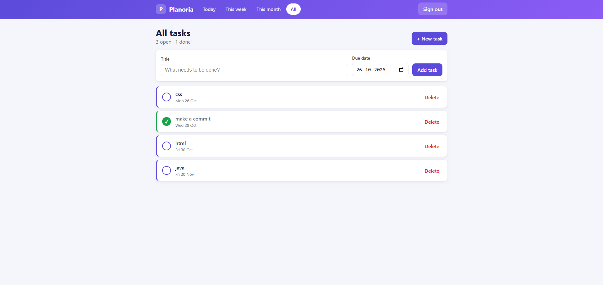

<p>
  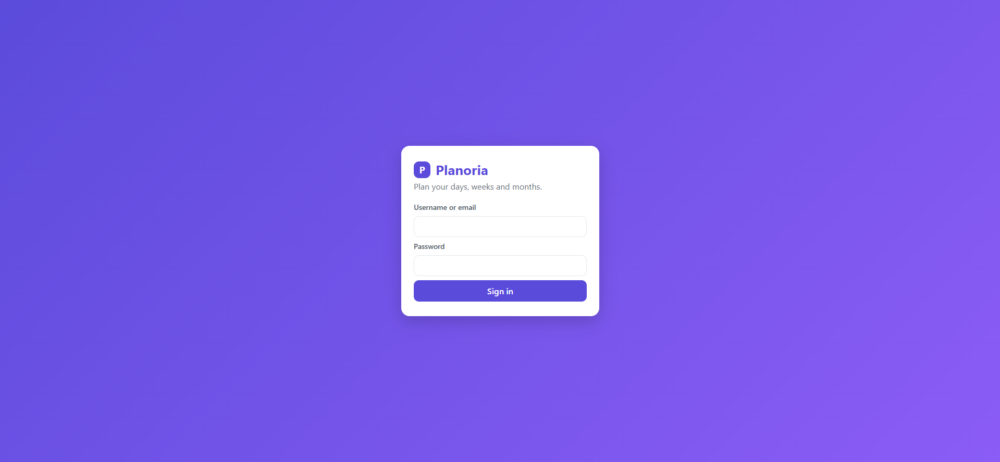
  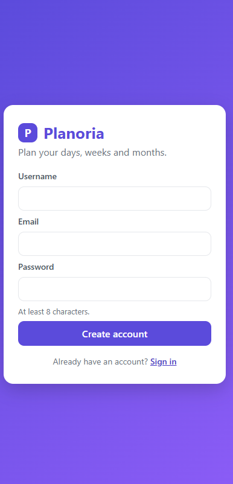
  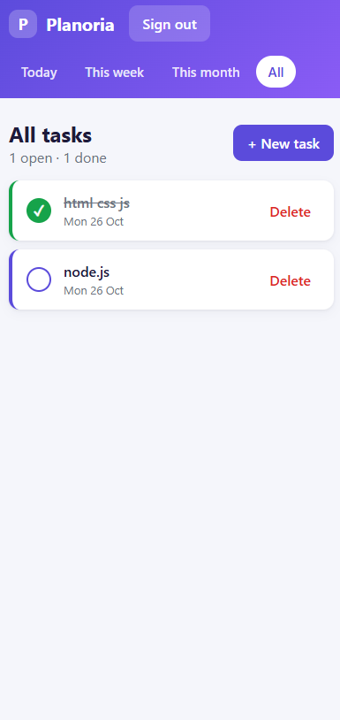
  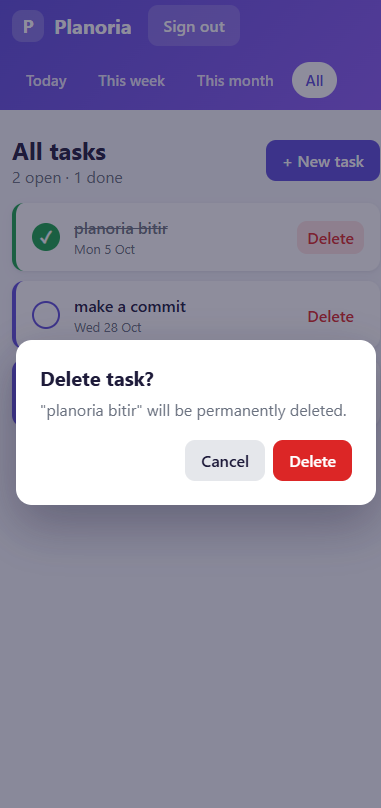
</p>

Run it (the API must be running on `http://localhost:5225`):

```powershell
dotnet tool install --global dotnet-serve   # once
cd Planoria.Web
dotnet serve -p 5500
```

Then open `http://localhost:5500`.

Notes:
- The API allows CORS only for `http://localhost:5500`, and only in the Development environment.
- The JWT is kept in `sessionStorage` and is cleared when the tab is closed.
- User-provided text is rendered with `textContent`, never `innerHTML`, to avoid XSS.
- Ownership is enforced by the API; the browser never decides who owns a task.

## MAUI app (Windows)

The desktop client still talks to the database directly and is being migrated to the API.

<p>
  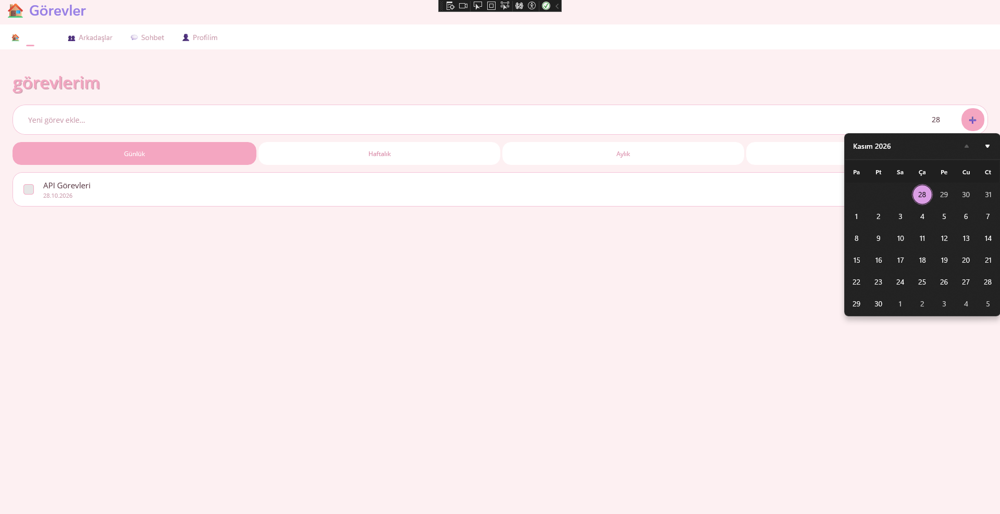
  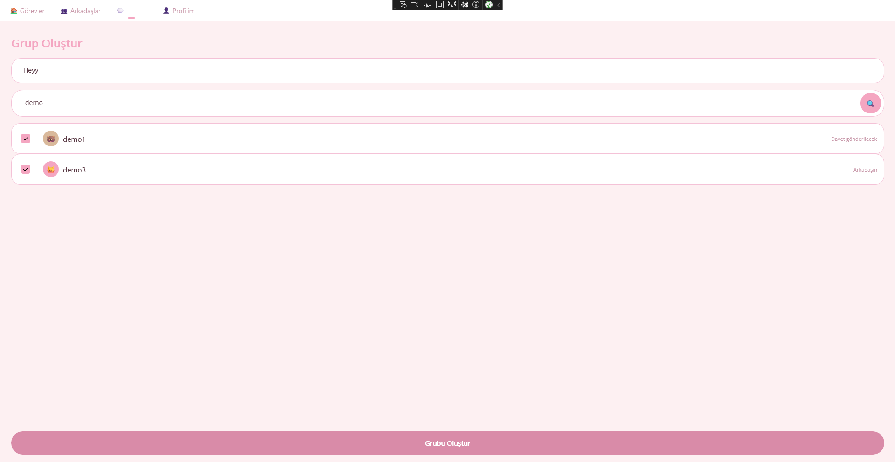
</p>
<p>
  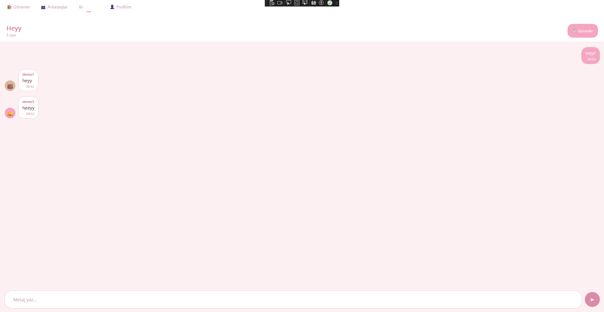
  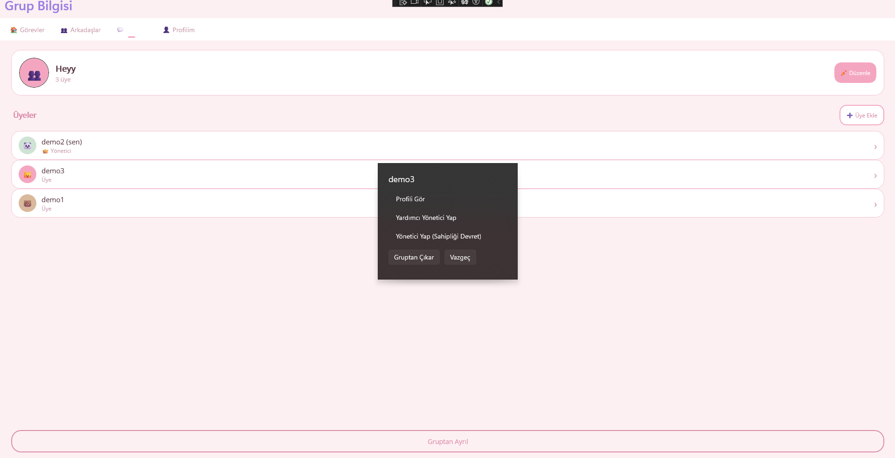
</p>
<p>
  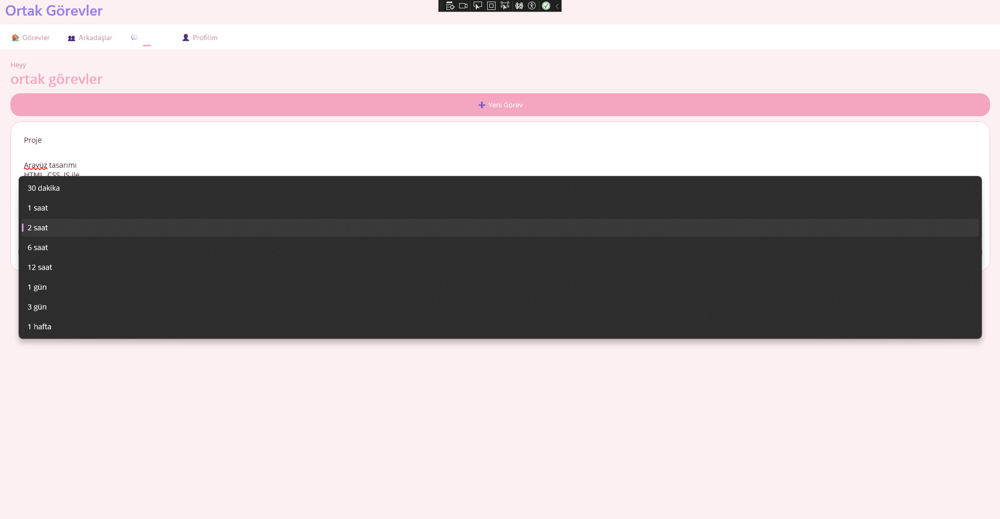
</p>

<details>
<summary>More screenshots</summary>

<p>
  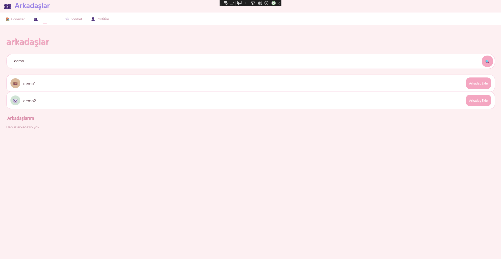
  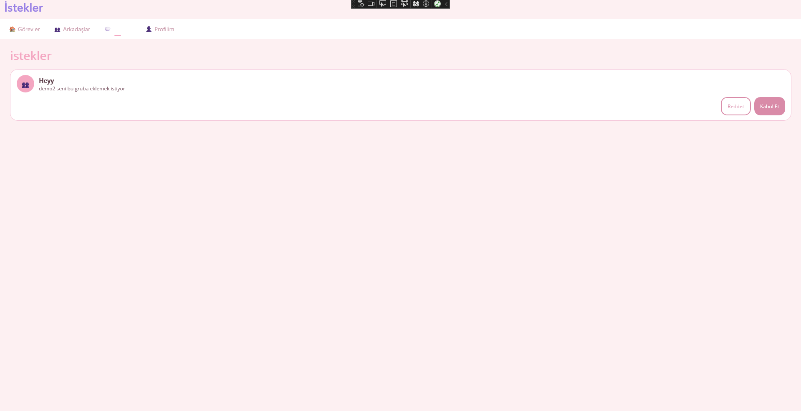
  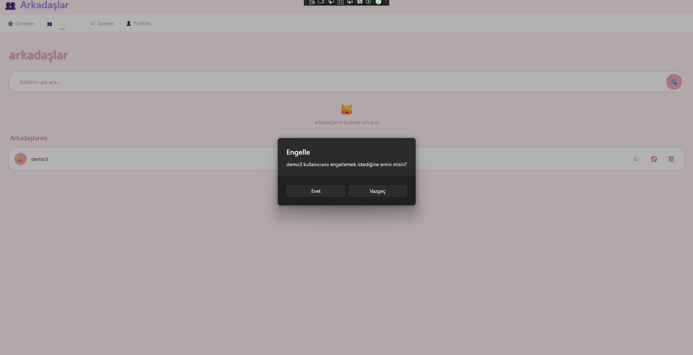
  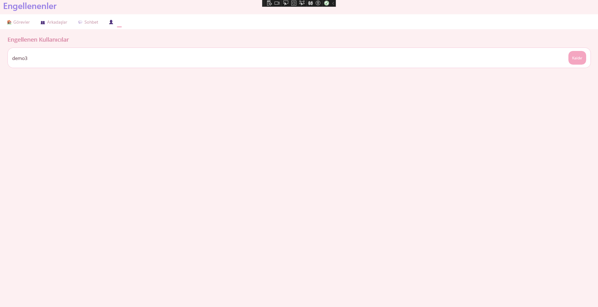
  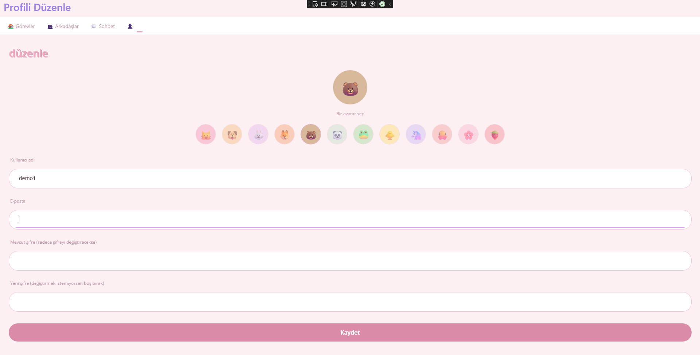
  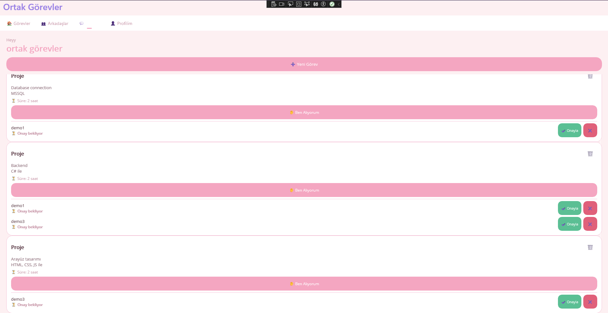
  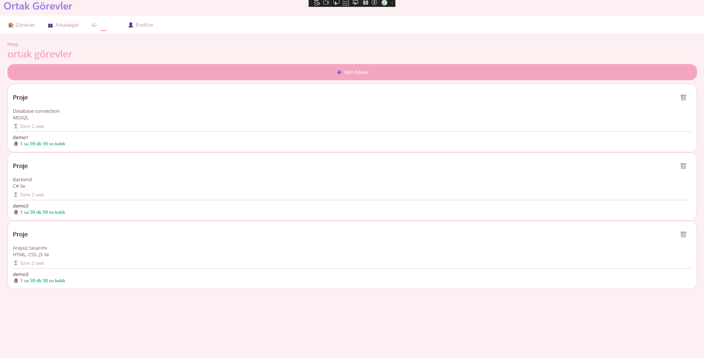
</p>

</details>

## Tests

```powershell
dotnet test Planoria.Api.Tests
```

Integration tests start the API in memory with an in-memory database (no SQL Server needed). They verify, among other things, that a user **cannot read, update, delete or complete another user's task** (404) and that requests without a token get 401.

## Security notes

- **Passwords** are hashed with BCrypt, never stored in plain text.
- **JWT** is validated for issuer, audience, lifetime and signature. The signing key lives in user-secrets.
- **Ownership:** the user id always comes from the token, never from the request. Every query filters by it, and other users' resources return **404** so their existence is not revealed.
- **DTOs** are used instead of exposing entities, which prevents mass assignment.
- **Login errors** use one generic message to avoid revealing which accounts exist.
- **Rate limiting** on auth endpoints (10 requests/minute per IP, HTTP 429).
- **No secrets in the repository.** The default connection string uses Windows authentication; `TrustServerCertificate=true` is for local development only.
- Server-generated timestamps (`CreatedAt`, `CompletedAt`) are stored and returned in UTC.

## Known limitations

- The MAUI app still talks to the database directly, so role rules there are enforced only in the UI. Moving it to the API is the next milestone.
- Friends, groups and chat endpoints are not in the API yet.
- No refresh tokens (access tokens last 60 minutes) and no e-mail verification.
- Only the Windows target of the MAUI app currently builds; the Android build fails with an `Aapt2Link` error.
- Data is not real-time; screens refresh on navigation.
- The web client currently supports tasks only (no friends, groups or chat yet).
- Due dates in the past are blocked in the web form and the MAUI date picker, but not yet in the API.

## Roadmap

- [x] Web client (login, task views, create/complete/delete)
- [x] Web client: registration page
- [ ] API: reject past due dates
- [ ] Friends, groups and chat endpoints
- [ ] Unread message counters
- [ ] Real-time messaging with SignalR
- [ ] Switch the MAUI app to the API
- [ ] Task filtering, sorting and search
- [ ] Refresh tokens and e-mail verification
- [ ] CI pipeline running the tests
- [ ] Android build fix